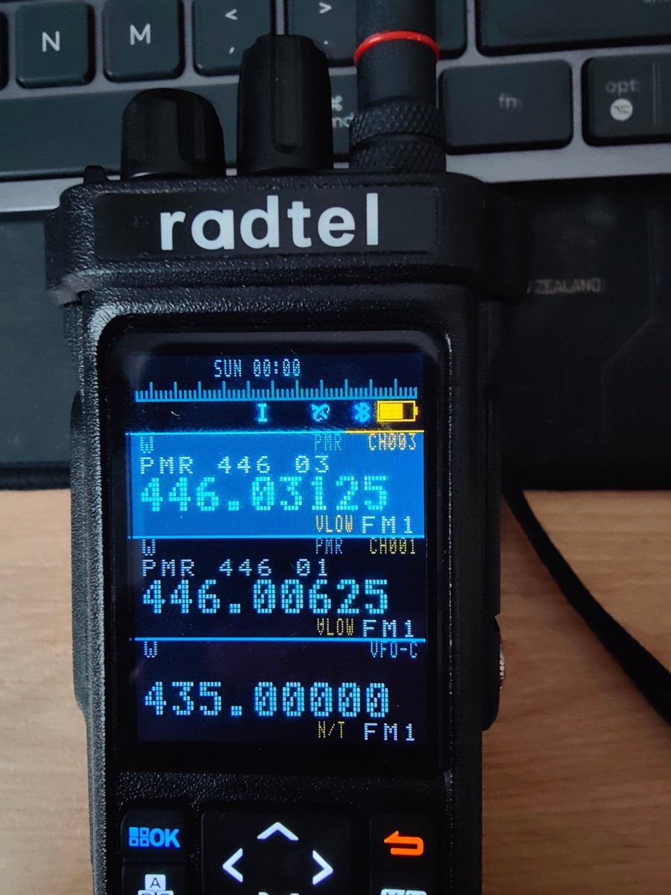
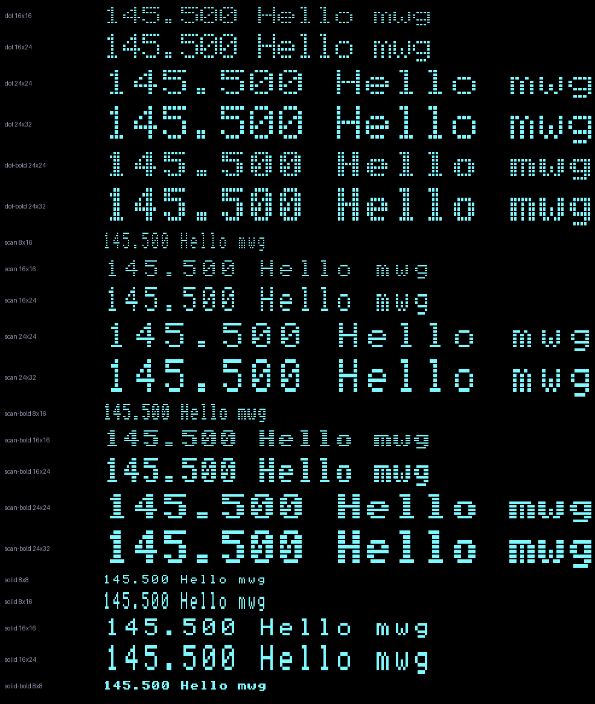
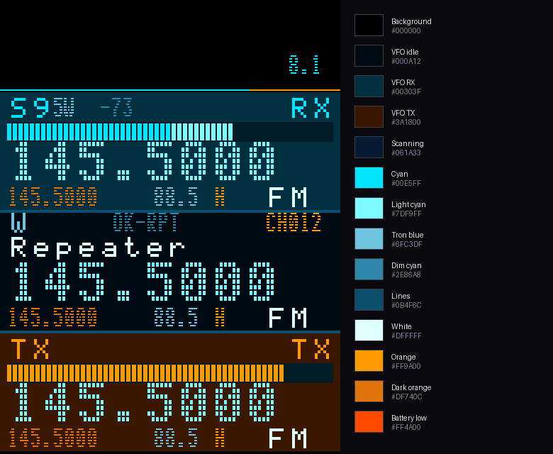

# Dot LCD font and themes for RT-950 nicFW

Dot LCD fonts and UI skins (themes) for radios running [nicFW](https://www.patreon.com/nicsure) (made on the Radtel RT-950 Pro), loadable through the nicFW RMS.

<p align="center"></p>

## Dot LCD fonts

Dot-matrix style fonts for the RMS **Fonts** tab. All sizes share one 5×8 character-LCD style glyph set (HD44780-like), with full lowercase and proper descenders.



### Styles

| Style | Look | Sizes |
|---|---|---|
| `dot` | Separate dots, horizontally and vertically | 16x16, 16x24, 24x24, 24x32 |
| `dot-bold` | Dots, vertical strokes 2 dots wide | 24x24, 24x32 |
| `scan` | Horizontally solid, gaps between rows (scanline look) | 8x16, 16x16, 16x24, 24x24, 24x32 |
| `scan-bold` | Scanline look, vertical strokes doubled | 8x16, 16x16, 16x24, 24x24, 24x32 |
| `solid` | Plain pixel font, no gaps | 8x8, 8x16, 16x16, 16x24 |
| `solid-bold` | Bold plain pixel font | 8x8 |

Not every style exists in every size: a 5-column glyph with 1 px gaps needs 9 px of width, so there is no dotted 8x16/8x8, and there is no room for a scanline gap in 8x8. Bold variants need 6–7 columns, so `dot-bold` only exists at 24 px width.

Mixing styles works well, for example `scan-bold` for the big frequency and `scan` or `solid` for small text. Each folder has a preview PNG per size.

### Dotted symbols

The repo does not ship a symbol font, but `tools/dot_symbols.py` turns your own copy of the 16x16 nicFW symbol font (exported from the RMS) into a partially dotted version that matches these fonts. Outlines and thin lines stay solid and only filled areas get a dot grid, so icons stay readable.

```
python3 tools/dot_symbols.py symbols.rmsfont symbols-dot.rmsfont
```

## Skins

UI layouts for the RMS UI editor. More skins will be added here over time.

### Tron Legacy



`skins/tron-legacy/ui-layout-tron.csv` is a colour scheme inspired by Tron Legacy: black background, cyan light lines and orange accents for TX. Import it in the RMS UI editor. It only changes colours and uses User Rects 1–4 as glowing separator lines. If the lines end up in the wrong place on your radio, set those four rows back to zeros. The preview is an approximate mock-up, not a screenshot from the radio.

## Installing

1. Back up your current fonts and UI in the RMS.
2. Fonts: in the RMS **Fonts** tab, load the `.rmsfont` file for the matching size and write it to the radio.
3. Skins: load the `.csv` layout in the RMS UI editor and write it to the radio.
4. A storage reset after a firmware update may clear custom fonts and UI, so keep the files.

## Building

The glyphs live in `tools/glyphs.py` as 5×8 ASCII art, plus hand-drawn bold versions of M, N, W, m and w. Rebuild every variant with:

```
pip install pillow
python3 tools/build_fonts.py fonts
python3 tools/overview.py overview.png
```

New styles or sizes are one line in `VARIANTS` in `build_fonts.py`: dot size, dot pitch, vertical offset and bold on or off.

## Credits

- nicFW and the RMS by nicsure (Marcus Dudley).
- The Dot LCD glyphs were inspired by the "Tom dot" font shared in the nicFW community.

## License

MIT, see [LICENSE](LICENSE). The fonts, skin and tools in this repository are covered by it. nicFW itself is not part of this repository.
